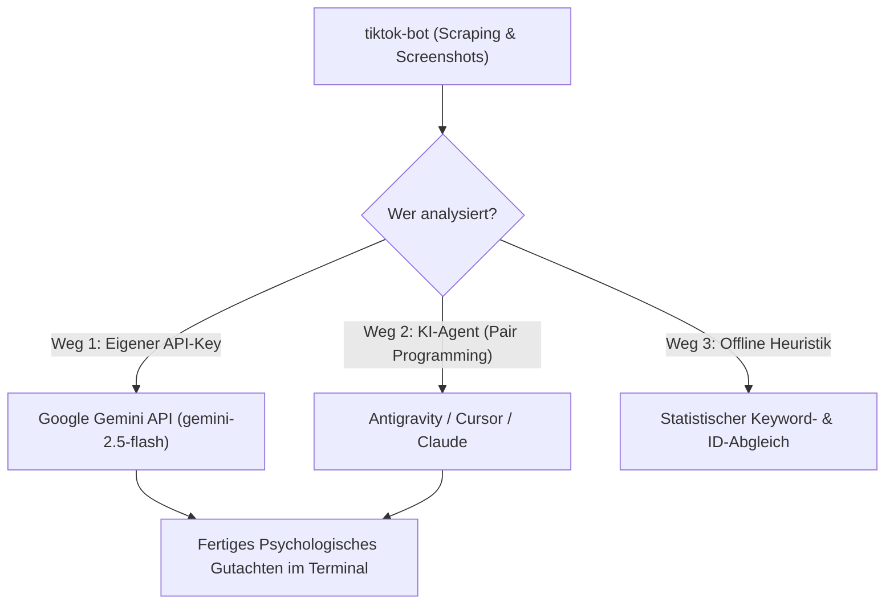

# 🤖 TikTok Intelligence & Visual Profile Agent (`tiktok-bot`)

[](https://www.python.org/downloads/)
[](https://playwright.dev/)
[](https://github.com/tesseract-ocr/tesseract)
[](https://aistudio.google.com/)

Ein autonomer Browser- und Social-Intelligence-Agent zur Erfassung, visuellen Analyse und psychologischen Kompatibilitätsbewertung von TikTok-Profilen, Videos und Reposts.

Entwickelt für **Linux (KDE Plasma Wayland / X11)** mit **Playwright**, **Tesseract OCR** und **Gemini LLM**.

---

## 🌟 Warum dieses Tool anders ist

Herkömmliche TikTok-Scraper scheitern an zwei Dingen:
1. **Bot-Erkennung & Login-Schranken:** TikTok blockiert Web-Scraper aggressiv. Dieses Tool nutzt eine **persistente Browser-Session** (`browser_profile`), wodurch dein echter Login und alle Cookies erhalten bleiben.
2. **Die Hashtag-Falle:** Hashtags wie `#fyp` oder `#viral` sagen nichts aus. **90 % der Botschaft, des Humors und der Emotionen liegen in den visuellen Text-Overlays auf dem Video.**

### Unsere Lösung:
* **📸 Visuelle Grid-Fotostrecke (`--screens N`):** Knipst in Sekunden aufeinanderfolgende Screenshots der Profil-Grid, scrollt automatisch weiter und erfasst 60–100 Videos gleichzeitig inklusive Texten und Bildmotiven.
* **👻 Lautlos im Hintergrund (`--headless`):** Arbeitet 100 % unsichtbar, ohne Popups auf deinem Desktop.
* **🔍 Lokale OCR-Volltextsuche (`tiktok-search`):** Erkennt Texte und Memes direkt in den Video-Overlays über Tesseract (Deutsch & Englisch).
* **💘 Kompatibilitäts-Matcher (`tiktok-match`):** Gleicht zwei Profile ab, findet identische Reposts und berechnet Match-Scores.

---

## 🧠 Zwei Wege zur KI-Analyse (Dual-Mode)

Dieses Repository unterstützt zwei Betriebsmodi:



### Weg 1: Standalone CLI mit Gemini API-Key
Setze einfach deinen kostenlosen API-Key:
```bash
export GEMINI_API_KEY="dein-api-key"
# oder trage ihn in .env ein
```
`tiktok-match` führt dann eine **vollwertige psychologische Tiefenanalyse** mit Google Gemini durch (inklusive Erkennung von verborgenem Subtext, Red/Green Flags und Date-Tipps).

### Weg 2: Im Teamwork mit einem KI-Agenten (Antigravity / Cursor / Claude)
Wenn du dieses Repository in einer agentischen KI-Umgebung nutzt:
* Der Agent führt die Befehle im Terminal aus.
* Der Agent liest die generierten Screenshots (`captures/<user>/grid_0X.png`) mit seinen eigenen multimodalen Vision-Fähigkeiten.
* Du benötigst **keinen eigenen API-Key**, da der Agent die Interpretation übernimmt!

---

## 🚀 Installation & Voraussetzungen

### 1. Systempakete installieren (Linux)
```bash
# Tesseract OCR & Firefox Abhängigkeiten (z.B. Ubuntu/Debian/Fedora)
sudo apt update && sudo apt install tesseract-ocr tesseract-ocr-deu ffmpeg
# Fedora: sudo dnf install tesseract tesseract-langpack-deu ffmpeg
```

### 2. Python-Bibliotheken installieren
```bash
pip install playwright pytesseract pillow websockets google-genai
playwright install firefox
```

### 3. CLI-Befehle global verlinken (Optional)
```bash
mkdir -p ~/.local/bin
ln -sf $(pwd)/agent.py ~/.local/bin/tiktok-bot
ln -sf $(pwd)/matcher.py ~/.local/bin/tiktok-match
ln -sf $(pwd)/ocr_search.py ~/.local/bin/tiktok-search
```

---

## 📖 CLI-Befehlsreferenz

### 1. Reposts erfassen & Fotostrecke knipsen
```bash
# 5 Screenshots im unsichtbaren Hintergrundmodus knipsen & Daten speichern:
tiktok-bot --profile username --reposts --screens 5 --headless

# Profil im sichtbaren Fenster öffnen:
tiktok-bot --profile username --reposts
```

### 2. Einmaliger Login (Interaktiver Modus)
Bleibt geöffnet, bis du im Terminal `Enter` drückst:
```bash
tiktok-bot --keep-open 0
```
*Tipp: Logge dich einmal ein – die Session bleibt für immer in `browser_profile/` gespeichert.*

### 3. Profile abgleichen (`tiktok-match`)
```bash
# Gleicht zwei Profile ab (lädt fehlende Daten automatisch nach!):
tiktok-match user1 user2

# Mit explizitem Gemini API-Key für KI-Bewertung:
tiktok-match user1 user2 --api-key "DEIN_KEY"
```

### 4. OCR-Volltextsuche in Bild-Overlays (`tiktok-search`)
```bash
# Sucht nach Wörtern in allen erfassten Screenshots:
tiktok-search "spazieren"
tiktok-search "bier"

# Gezielt bei einem bestimmten Nutzer suchen:
tiktok-search --user username "freitag"
```

---

## 📁 Projektstruktur

```
tiktok-agent/
├── agent.py                 # Haupt-Agent (Playwright-Steuerung & Grid-Capture)
├── matcher.py               # Profil-Matcher (Gemini AI + Heuristik)
├── ocr_search.py            # Tesseract OCR Suchmaschine
├── analyze_mood.py          # Timeline-Stimmungsanalyse
├── .env.example             # Vorlage für API-Keys
├── .gitignore               # Schützt Login-Cookies & Screenshots
└── captures/                # Gespeicherte Grid-Screenshots pro User
```

---

## 🔒 Datenschutz & Sicherheit

> [!CAUTION]
> **Niemals den Ordner `browser_profile` auf GitHub pushen!**  
> Die `.gitignore` schützt diesen Ordner standardmäßig, da darin deine aktiven Anmelde-Cookies (`cookies.sqlite`) gespeichert sind.

---

## 🛠️ GitHub Push-Anleitung

Um das Projekt in dein eigenes GitHub-Repository zu laden:

```bash
cd ~/.local/bin/tiktok-agent
git init
git add .
git commit -m "feat: Initial commit of TikTok visual intelligence agent"
git branch -M main
git remote add origin https://github.com/<dein-user>/tiktok-agent.git
git push -u origin main
```

---

*Entwickelt als Pair-Programming-Projekt zwischen Entwickler und KI-Agent.*
